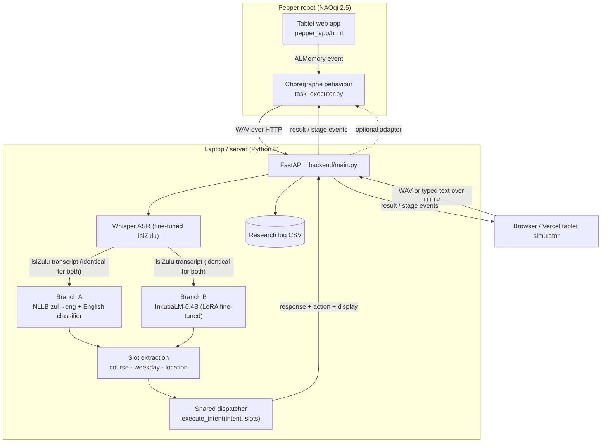

# isiZulu Wits Assistant

The tablet interface and speech-to-action pipeline for **Making Pepper Bot
Understand isiZulu**, a BSc Honours research project at the University of the
Witwatersrand. A student speaks naturally in isiZulu. Whisper transcribes it,
an intent branch (A or B) works out what the student wants, and a shared
dispatcher has Pepper perform the task.

```
Pepper App Launcher → "isiZulu Wits Assistant" → tablet page → student speaks isiZulu
  → Whisper ASR → Branch A or Branch B → canonical intent + slots → dispatcher → Pepper responds
```

## Status

The application is complete as a **pipeline and interface**. The research
models plug into it, and the ones that are not trained yet are clearly marked.
No experimental score appears anywhere in this repository.

| Stage | What | State |
| --- | --- | --- |
| 1 | Tablet frontend, with demo responses when no backend is reachable | Done |
| 2 | Python backend and `/api/health` | Done |
| 3 | Browser recording → 16 kHz WAV → upload | Done |
| 4–5 | Whisper ASR, transcript shown in the UI | Code done. Loads the DSFSI checkpoint or your fine-tuned one via `WHISPER_MODEL`. Not run here without weights. |
| 6 | Branch A: NLLB-200 translation → English classifier | Done: RoBERTa-base fine-tuned on the English versions of the 500 requests (`./EnglishIntentClassifier`, from the Colab notebook), with the untrained `zero-shot` baseline. |
| 7 | Branch B: InkubaLM-0.4B | Done: LoRA fine-tuned on the 500 verified requests (adapter from the Colab notebook), with an untrained few-shot fallback. |
| 8–9 | Shared dispatcher wired to the UI | Done |
| 10 | Choregraphe / Pepper integration | Code done (`pepper_app/`). Untested on a robot. The NAOqi version is still unconfirmed. |
| 11 | Research logging, WER/CER, macro-F1, McNemar, batch evaluation | Done |
| 12 | Vercel deployment | Configured (`frontend/vercel.json`). Not deployed from this repo. |

Until real models are configured, both branches run **`dev-rules`**: keyword
stand-ins that exist only to test the plumbing. Without the ML libraries,
Branch A's stand-in cannot translate, so isiZulu input comes out as OOS. With
them installed, Branch A defaults to **`nllb-rules`**: real translation feeding
the same English keyword stand-in. Every result, log row and
health check names the engine that produced it, and the report tool drops
`dev-rules` rows by default.

## Architecture



Each branch receives the **same transcript** and returns a **canonical intent
plus slots**:

```json
{ "intent": "ask_course_venue", "slots": { "course": "COMS4054A" } }
```

Slots are filled by one shared keyword extractor, so the A/B comparison
isolates the intent decision. The dispatcher never knows which branch
produced the intent. Pepper-specific execution sits behind an adapter, so the
same result drives the browser simulator, Choregraphe's virtual Pepper, and
later the physical robot.

### Intents

`greeting`, `help`, `ask_time`, `ask_current_class`, `ask_next_class`,
`ask_lecturer`, `ask_course_time`, `ask_course_venue`, `ask_day_schedule`,
`list_courses`, `ask_current_semester`, `open_self_service`, `ask_contact`,
`ask_directions`, `OOS`. Slots: `course`, `weekday` (including
`today`/`tomorrow`), `location` (a campus place or an `MSL` room), and `contact`.
Defined once in [`data/intents.json`](data/intents.json).

### Verb first, then subject

After the intent model, Pepper reads the isiZulu transcript in two steps
(`backend/nlu/frame.py`, vocabulary in `data/action_lexicon.json`):

1. **The verb**: help (*siza*), open (*vula*), show (*bonisa*), find (*thola*,
   *fika*), contact (*shayela*, *thinta*), teach (*fundisa*), tell (*tshela*,
   *azi*), or a question word: where (*kuphi*), when (*nini*), who
   (*ngubani*), what (*sini*, *yini*). Stems are matched inside inflected words
   (*ungisize*, *ungivulele*).
2. **The subject**: time, exams, courses/classes, the timetable, lecturers, the
   calendar, Self-Service, contacts, places, or any known course, place,
   weekday or contact name.

| Verb | Subject | Pepper |
| --- | --- | --- |
| recognised | in scope, model intent fits | carries out the request |
| recognised | unknown (e.g. *ngisize ngama student fees*) | the verb's refusal: "Sorry, I cannot help with that." / "Sorry, I cannot open that." |
| recognised | in scope, verb cannot apply | refusal, then what it can do about the subject |
| recognised | none | what that verb can do |
| not recognised | in scope (e.g. *… isikhathi*) | every capability about that subject |
| neither | | the model's intent (e.g. greetings) |

The analysis is identical for Branch A and B. Logs keep `predicted_intent`
(the model, used for accuracy and macro-F1) apart from `executed_intent` and
`policy` (what Pepper did, used for task completion).

### What it knows

Pepper stands in the **TW Kambule Mathematical Sciences Building**. It answers
from public Wits information in [`data/`](data/README.md): the 11 Honours
Computer Science courses and their November 2026 exams, the 2026 academic
calendar, School contacts, and campus locations. Directions give the campus
side and grid square from the official campus map, and the tablet shows the
map with "you are here" and destination pins.

## Repository layout

```
frontend/            static tablet app: HTML, CSS, ES5 JavaScript, no build step
  js/ app.js (state machine) · api.js · recorder.js · pepper.js · demo.js · ui.js · config.js
  vercel.json, build-env.js
pepper_app/          Choregraphe package: manifest, behaviour, task executor, html/ (generated)
backend/
  main.py            FastAPI endpoints
  pipeline.py        one trial: ASR → branches → dispatcher → adapter → log
  asr/               Whisper engine
  branch_a/          NLLB translator + HF / zero-shot English classifier
  branch_b/          InkubaLM: fine-tuned (adapter) and few-shot label scoring
  nlu/               canonical intents, slot extraction, dev-rules stand-in
  dispatcher/        execute_intent, timetable, Pepper adapter
  evaluation/        metrics, research log, report, batch evaluator
data/                courses & exams, calendar, contacts, locations, intents (see data/README.md)
scripts/             sync_pepper_html.py
tests/               pytest suite
```

## Run it locally

Requires Python 3.10+.

```bash
python -m venv .venv
```

```bash
source .venv/bin/activate
```

```bash
pip install -r backend/requirements.txt
```

```bash
uvicorn backend.main:app --reload --port 8000
```

In a second terminal, serve the frontend:

```bash
python -m http.server 5173 --directory frontend
```

Open <http://localhost:5173>. The status pill reads **Assistant online**.
With no models installed, the microphone works but the backend reports that
ASR is not configured. Use research mode's **Bypass ASR** box to send typed
text through the branches. If the backend is not running, the page falls back
to a clearly labelled **demo mode** that only exercises the UI states.

**Research mode:** press and hold the crest for 1.5 seconds, or open
`?mode=research`. Students never see it.

### Turn on the models

```bash
pip install -r backend/requirements-ml.txt
```

Then configure engines with environment variables (see `.env.example`):

| Variable | Purpose |
| --- | --- |
| `ASR_ENGINE=whisper`, `WHISPER_MODEL=<hub id or path>` | Fine-tuned Whisper checkpoint. Defaults to `./WhisperModel` when `model.safetensors` is there (weights are git-ignored, so copy them in locally), otherwise the DSFSI hub checkpoint. `WHISPER_LANGUAGE` overrides the checkpoint's language token; the DSFSI model has no isiZulu token, so use the one your notebook trained with. Decodes with beam size 5 by default (`WHISPER_NUM_BEAMS`; 1 = greedy), matching the best AST evaluation (16.25% WER vs 17.23% greedy); the decoding is recorded with every logged trial (e.g. `whisper-beam5`). Repetition controls are off unless set. |
| `BRANCH_A_ENGINE=hf`, `BRANCH_A_CLASSIFIER=<path>` | NLLB-200 (`zul_Latn`→`eng_Latn`) plus the fine-tuned English classifier. Used automatically when `./EnglishIntentClassifier` exists (from cell 11 of `branch_a_english_cv.ipynb`; git-ignored). Its `id2label` must use the canonical labels; the backend refuses any others. `BRANCH_A_CLASSIFIER=none` ignores it. |
| `BRANCH_A_ENGINE=nllb-rules` | The default once the ML libraries are installed and no classifier is set. Real NLLB translation, so isiZulu works end to end, but intents come from the English keyword stand-in. Excluded from reports. |
| `BRANCH_A_ENGINE=zero-shot` | NLLB-200 plus an NLI model scoring each intent's English hypothesis. A no-training baseline; report it as one. |
| `BRANCH_B_ENGINE=inkubalm` | `lelapa/InkubaLM-0.4B`, the default once the ML libraries are installed. Uses the LoRA adapter in `./InkubaLMAdapter` (or `INKUBALM_ADAPTER=<path>`; `none` for the untrained mode). `INKUBALM_DEVICE` (`auto`: CUDA if available, else CPU), `INKUBALM_DTYPE` (default `float32`). |
| `DEVICE` | `cuda`, `mps` or `cpu` (default: auto) |
| `PEPPER_EXECUTOR_URL` | Forward executed results to the Pepper bridge |

**How Branch B classifies.** With the fine-tuned adapter, every one of the 15 canonical
labels is scored as the continuation of `### isiZulu command:\n<transcript>\n### Intent:`
(all its tokens plus end-of-sequence), and a softmax over the labels gives a probability, so
the output is always a valid label. This is exactly how the Colab notebook scores during
cross-validation. Without an adapter, Branch B falls back to an untrained few-shot mode
(labelled requests from [`data/branch_b_examples.json`](data/branch_b_examples.json) in the
prompt); that mode scored below chance and is kept only so the system runs without an adapter.

## Three ways the frontend runs

1. **Desktop browser** (development): as above.
2. **GitHub Pages or Vercel** (hosted research/demo UI): static files only. Whisper
   and InkubaLM stay on the Python backend, on suitable hardware. GitHub Pages is
   published by `.github/workflows/pages.yml` on every push to `main` that changes
   `frontend/` (one-time setup: Settings > Pages > Source: GitHub Actions; the
   repository must be public on a free plan). The site is then at
   `https://<user>.github.io/PhilaniPepper/`; open it once with
   `?api=<backend URL>` (e.g. `?api=http://localhost:8000` in Chrome or Edge on the
   computer running the backend) and it remembers the backend.
3. **Pepper tablet**: `pepper_app/html/`, generated by
   `python scripts/sync_pepper_html.py`. This copy sets `runtime: "pepper"`
   and inlines CSS variables for the older tablet WebView. The tablet raises
   NAOqi events instead of recording. See [`pepper_app/README.md`](pepper_app/README.md).

### Deploy to Vercel

1. Import the GitHub repository in Vercel and set **Root Directory** to `frontend`.
2. Optionally set the environment variable `API_BASE_URL` to your backend's
   **HTTPS** URL. `build-env.js` writes it into `js/env.js` at build time.
3. Deploy. You can also point any deployment at a backend with
   `?api=https://…`, or with the research panel's **Backend** box (remembered
   per browser).

The hosted page is HTTPS, so browsers block calls from it to a plain-HTTP LAN
address such as `http://192.168.x.x:8000`. Calls to `http://localhost:8000`
on the same machine are allowed: the backend sends the Private Network
Access header. For another device, expose the backend over HTTPS (for
example a Cloudflare or ngrok tunnel), or run the frontend locally. The
microphone also needs HTTPS or localhost.

## API

| Method & path | Purpose |
| --- | --- |
| `GET /api/health` | Engines in use, load errors, sample-data flag |
| `POST /api/process` | **Main flow.** Multipart: `audio` (WAV preferred) or `text`, `branch` = `A`/`B`/`both`, `primary`, `session_id`, `trial_id`, optional ground truth (`reference_transcript`, `true_intent`, `true_course`, `true_weekday`), `log`, `save_audio`, `stream`. With `stream=true` it returns NDJSON stage events (`received → transcribing → transcribed → classifying → executing → result`), which the UI uses for real progress. |
| `POST /api/transcribe` | ASR only |
| `POST /api/classify/a`, `POST /api/classify/b` | `{"text": …}` → intent, slots, confidence, latency |
| `POST /api/execute` | `{"intent", "slots"}` → dispatcher result |
| `GET /api/courses`, `GET /api/schedule?weekday=` | Courses, exams and calendar; what is on a day |
| `GET /api/intents` | Canonical labels |
| `POST /api/evaluate/asr` | `{"reference", "hypothesis"}` → WER and CER with S/D/I counts |
| `GET /api/research/summary`, `GET /api/research/export` | Report JSON, raw CSV |

Example `/api/process` result (abridged):

```json
{
  "transcript": "i-nlp ikuphi?",
  "branch": "B",
  "intent": "ask_course_venue",
  "slots": { "course": "COMS4054A" },
  "confidence": null,
  "response": "The COMS4054A Natural Language Processing lab exam is on Tuesday 10 November from 14:00 to 17:00, in MSL005 and MSL006, in this building.",
  "action": { "type": "show", "text": "…" },
  "display": { "kind": "course", "code": "COMS4054A", "exams": [ … ] },
  "branches": { "B": { "engine": "dev-rules", "intent": "ask_course_venue", … } },
  "latency": { "asr_ms": null, "translation_ms": null, "classification_ms": 5.1, "execution_ms": 0.1, "total_ms": 22.0 }
}
```

All latencies are measured server-side with `time.perf_counter()`. A value is
`null` when that stage did not run. The research panel also shows the
client-measured round trip.

## Research workflow

Research mode lets you choose Branch A, Branch B or **Compare both**. With
both, the branches get identical input and the panel shows predictions side
by side with agreement. You can enter optional ground truth, a reference
transcript for WER/CER, and opt in to logging and audio saving. Normal
student use logs nothing.

| Research question | Where the evidence comes from |
| --- | --- |
| RQ1: task-completion rate | `task_correct` per logged row (intent plus gold slots) |
| RQ2: constrained-domain WER | Logged audio trials with a reference transcript; `/api/evaluate/asr` |
| RQ3: Branch A macro-F1 | `report` or `batch` |
| RQ4: A vs B, paired | Exact McNemar test on trials where both branches saw the same input |
| Latency | Per-stage and total, in milliseconds |
| ASR errors downstream | Intent accuracy split by WER = 0 vs WER > 0 |

Summarise a log:

```bash
python -m backend.evaluation.report data/logs/research_log.csv
```

Run a labelled text dataset through both branches. This answers RQ3/RQ4 even
without recordings. Only `verified=yes` rows are used:

```bash
python -m backend.evaluation.batch data/intent_dataset.csv --branches both
```

The dataset follows [`data/intent_dataset_template.csv`](data/intent_dataset_template.csv).
Add `--use-audio` to transcribe `audio_path` first.

## Privacy and safety

- The assistant never asks for, receives or stores passwords, logins or
  tokens. "Open Self-Service" only links to <https://self-service.wits.ac.za/>,
  where students sign in on the official page.
- Logging and audio saving are opt-in, per trial, from research mode only.
  `data/logs/` and `data/recordings/` are git-ignored.
- No credentials or API keys are in the repository. Use `.env` (ignored)
  for local settings.

## Look and feel

The interface follows the project owner's portfolio style in one dark theme
(`#1f1f1f` background, white text): **Bebas Neue** for headings, labels and
buttons, **Alice** for spoken text (both from Google Fonts), glossy gradient
buttons, bordered cards that lift on hover, and a gold scrollbar. Accents are Wits gold `#ffb91c` and blue
`#002d72`. Without internet (e.g. on Pepper offline) headings fall back to
the committed **Grotesk Medium** font, then `"Arial Narrow", Arial`. The Wits
crest in `frontend/assets/` is used for this University project; confirm the
use with University brand guidelines before any public deployment.

## Branch B (InkubaLM)

Model training happens outside this repository, in the Colab notebook
`branch_b_lora_cv.ipynb` (LoRA, transformers 4.46.3, peft 0.13.2):

- **Evaluation:** cells 1–10 run 5-fold cross-validation on `data/test_sentences_500.csv`
  (a request and its "Pepper, ..." variant always in the same fold) and evaluate the
  out-of-fold predictions with Branch A through `backend.evaluation.batch`. These are the
  results to report.
- **Deployment:** cell 11 trains one adapter on all 500 requests and downloads
  `InkubaLMAdapter.zip`. Unzip it into this folder as `InkubaLMAdapter/` (git-ignored);
  the backend then uses it automatically. It has seen every one of the 500 requests, so
  **never evaluate it on them**.

On load, the backend refuses an adapter whose `training_info.json` has a different prompt
or intent list, or whose weights are not finite. Check Branch B with
`python -m backend.branch_b.diagnose`: it should report `LoRA adapter ./InkubaLMAdapter` and
end with "Branch B is working". InkubaLM runs its own model code (`trust_remote_code`),
which produces NaN under transformers 5.x, so keep transformers below 4.47
(`backend/requirements-ml.txt`).

## 3D Pepper

The robot panel can show a 3D Pepper, assembled from the official Pepper
URDF and rendered with three.js r147 (bundled in `frontend/vendor/three/`,
MIT). It animates with the assistant: idle breathing, looking up while
listening, hand-to-chin while working, presenting the answer, and looking
down on errors. Drag it to turn it. Where the meshes or WebGL are missing
(the public Vercel site, older Pepper tablet browsers) the 2D face is shown
and three.js is never downloaded.

The meshes are (c) SoftBank Robotics / Aldebaran under **CC BY-NC-ND 4.0**,
and may only be redistributed when the user explicitly accepts that licence,
so they are **not in this repository**. Install them locally:

```bash
python scripts/install_pepper_meshes.py
```

It asks you to type `yes` to the licence, then downloads the unmodified
files into `frontend/assets/pepper3d/meshes/` (git-ignored). By default it
uses the copy in Maelic/llm-agent-pepper-robot; with
`--from <folder>` it copies from an official install of `ros-naoqi/pepper_meshes`.
Run `python scripts/sync_pepper_html.py` afterwards for the Pepper tablet build.

`frontend/assets/pepper3d/pepper-model.json` (committed) holds only the joint
frames and mesh names, generated from the Apache-2.0 URDF in
ros-naoqi/pepper_robot by `scripts/build_pepper_model.py`.

## Tests

```bash
python -m pytest
```

The tests cover WER/CER, macro-F1, McNemar, slot extraction, every dispatcher
intent, the API (streaming, errors, opt-in logging, dev-row exclusion),
Pepper package validity, and that `pepper_app/html` is in sync with `frontend/`.

## Known limitations

Items still to be checked are listed in `verifythese.txt`.

- Weekly lecture times and per-course lecturers are not in the data yet (see `data/README.md`).
- Pepper's responses are in English, through the robot's English TTS.
- The Pepper package has not been run on a robot and targets NAOqi 2.5 only.
